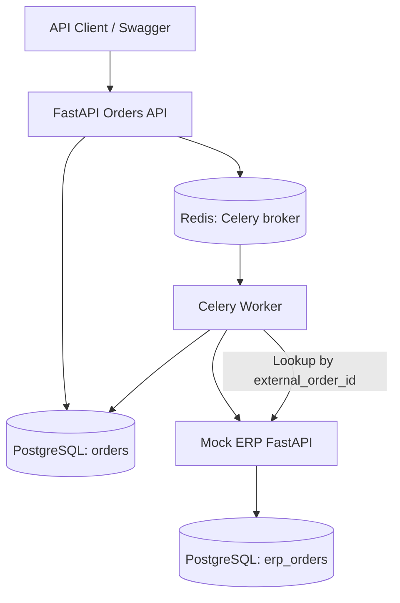

# PRD — Order-to-ERP Integration Simulator

**Version:** 1.0  
**Status:** Ready for implementation  
**Language:** Python 3.12  
**Audience:** Coding agent and developer  
**Purpose:** Portfolio and technical-interview preparation; not production deployment.

## 1. Product overview

Build a small, reliable B2B order integration service. A client submits an order through a REST API. The application validates and persists it, then asynchronously transmits it to a simulated external ERP. Users can query processing status, inspect errors, and safely request a retry. The mock ERP must support controlled failure scenarios, including a lost response after successful order creation.

The project is designed to practice Python backend engineering, SQL, asynchronous processing, external API integration, idempotency, testing, and operational troubleshooting.

### Goals

1. Expose a documented REST API to create and query orders.
2. Persist orders and processing metadata in PostgreSQL.
3. Dispatch outbound ERP integration through Celery and Redis, without blocking HTTP requests.
4. Correctly distinguish definite failures from uncertain outcomes (timeouts after a possible side effect).
5. Prevent duplicate ERP orders through stable external identifiers and reconciliation.
6. Provide reproducible integration tests and observability sufficient to explain system behavior.

### Non-goals (MVP)

- Real SAP/Sage/NetSuite integration or credentials.
- Authentication, multi-tenancy, frontend UI, billing, and email ingestion.
- LLM-based PDF extraction.
- Guaranteed exactly-once delivery or full production hardening.
- Kubernetes, cloud deployment, distributed tracing infrastructure.

## 2. Users and key scenarios

**API client:** creates orders and polls status.  
**Operator/developer:** investigates failures, tests retry behavior, and examines logs.  
**Mock ERP:** emulates an external system with variable latency and reliability.

### Primary flow

1. Client calls `POST /orders` with a valid customer, product, and positive quantity, optionally supplying `Idempotency-Key`.
2. API validates input and creates a database order with status `PENDING`.
3. API schedules a Celery task and responds `202 Accepted` with the order ID and status URL.
4. Worker claims the order, marks it `PROCESSING`, and calls mock ERP with a stable `external_order_id`.
5. Mock ERP accepts the order and returns its ERP ID; worker records `SUCCESS` and `erp_order_id`.
6. Client calls `GET /orders/{id}` to retrieve the result.

### Failure flows

- **Temporary ERP failure (429/503):** retry with exponential backoff and bounded attempts; respect `Retry-After` where feasible.
- **Permanent validation error (400/422):** mark `FAILED`, do not retry automatically.
- **Timeout / connection loss:** status becomes `UNKNOWN` when a side effect cannot be ruled out. Reconcile against mock ERP by `external_order_id` before another creation attempt.
- **Duplicate client request:** if the same `Idempotency-Key` and equivalent payload are reused, return the original order; same key with a different payload returns `409 Conflict`.
- **Manual retry:** allowed only for `FAILED` and `UNKNOWN`; retry performs reconciliation before any ERP create call. Concurrent retry requests must not schedule competing work.

## 3. Functional requirements

### FR-01 Create order

`POST /orders`

Example request:

```json
{
  "customer_id": "CLIENT-123",
  "product_id": "PRODUCT-456",
  "quantity": 10
}
```

Validation: nonempty customer/product IDs (trim whitespace), quantity integer > 0; reject unexpected fields. Server generates UUID `id` and `external_order_id` (stable and unique; using the order UUID is acceptable). Support optional `Idempotency-Key` header; enforce unique key at database level.

Response: `202 Accepted`, including `id`, `status`, `external_order_id`, `created_at`, and a `status_url` such as `/orders/{id}`. Repeated requests with the same idempotency key and same normalized payload return the same order (do not enqueue a second task).

### FR-02 Read order

`GET /orders/{id}` returns order fields plus `status`, `erp_order_id` (nullable), `attempt_count`, `last_error` (sanitized), `created_at`, and `updated_at`. Return 404 for unknown IDs.

### FR-03 List orders

`GET /orders?status=PENDING&limit=20&offset=0`; default limit 20, maximum 100. Return a paginated result with `items`, `total`, `limit`, and `offset`. Sorting newest first.

### FR-04 Manual retry

`POST /orders/{id}/retry` responds `202` when accepted. Return `409` for states not eligible for manual retry. Retry should enqueue at most one active task for an order. Do not reset `external_order_id`.

### FR-05 Health

`GET /health` returns HTTP 200 and `{ "status": "ok" }` when the API process is running. Optional `/ready` can check PostgreSQL/Redis separately; do not claim `/health` verifies dependencies.

### FR-06 Mock ERP

Separate FastAPI app on port 8001:

- `POST /erp/orders`: creates or returns an order identified by `external_order_id`.
- `GET /erp/orders/by-external-id/{external_order_id}`: returns the existing ERP order or 404.
- Persist mock ERP records in PostgreSQL (separate table) to survive service restarts.
- Enforce uniqueness on `external_order_id` and return the same ERP order on repeated equivalent requests; reject conflicting payloads with 409.
- Enable **development-only** deterministic failure modes: `normal`, `http_503`, `http_429`, `timeout_before_create`, `timeout_after_create`, `http_400`. Prefer a configurable mock scenario via environment or a test-only endpoint; document how to reset it. In `timeout_after_create`, commit the ERP order before delaying beyond the client's timeout.

### FR-07 Worker processing

- Celery task takes an **order ID only** and reloads order data from PostgreSQL.
- Use stable `external_order_id` on every outbound attempt.
- Claim work safely using a DB transaction / conditional status update or row lock to avoid simultaneous sends.
- Record attempt count, timestamps, and sanitized error information.
- Distinguish transient errors, permanent errors, and uncertain outcomes.
- On uncertain outcomes, perform ERP lookup before sending again. A found matching order transitions to `SUCCESS`.
- Use exponential backoff with jitter for transient failures, bounded to a configurable maximum (e.g. 3 attempts initially).
- Ensure database sessions and HTTP clients are closed properly.

### FR-08 Observability

- Structured logs containing `order_id`, `external_order_id`, `attempt`, `event`, and error category; never log credentials.
- Document common failure modes and investigation steps in README.
- Expose task status through database-backed API, not solely Celery result backend.

## 4. Status model

| Status | Meaning | Typical next status |
|---|---|---|
| `PENDING` | Stored, waiting to be processed | `PROCESSING` |
| `PROCESSING` | Worker has claimed order | `SUCCESS`, `FAILED`, `UNKNOWN`, `PENDING` |
| `SUCCESS` | ERP creation confirmed or reconciled | Terminal |
| `FAILED` | Permanent failure or retry budget exhausted with a known failure | `PENDING` via manual retry |
| `UNKNOWN` | ERP may have created the order; outcome unconfirmed | `SUCCESS`, `FAILED`, `PENDING` after reconciliation |

Never assume that a timeout proves an ERP request failed. If a lookup is temporarily unavailable, keep the order `UNKNOWN` and retry reconciliation later rather than blindly creating a duplicate. The implementation should document whether retry scheduling is represented as `PENDING` or a separate internal field; maintain one consistent state machine.

## 5. Data model

### `orders`

| Field | Type / constraint |
|---|---|
| `id` | UUID primary key |
| `customer_id` | non-null varchar |
| `product_id` | non-null varchar |
| `quantity` | positive integer |
| `external_order_id` | unique non-null varchar |
| `idempotency_key` | unique nullable varchar |
| `request_hash` | nullable varchar (canonical normalized payload hash) |
| `status` | enum/string with validation |
| `erp_order_id` | nullable varchar |
| `attempt_count` | integer default 0 |
| `last_error` | nullable text, sanitized |
| `created_at`, `updated_at` | timezone-aware timestamps, UTC |

### `erp_orders` (mock ERP)

`id` (UUID), `external_order_id` (unique), `customer_id`, `product_id`, `quantity`, `created_at`.

**Optional later:** `order_events` table for state-transition history; `outbox_events` table for reliable task publication.

## 6. Technical stack

- Python 3.12, `uv` for environment and dependency management.
- FastAPI, Uvicorn, Pydantic v2, pydantic-settings.
- PostgreSQL 16, SQLAlchemy 2.x, psycopg 3, Alembic.
- Celery 5.x and Redis 7 for background processing.
- HTTPX for ERP requests.
- pytest, pytest-asyncio, Ruff for testing and linting.
- Docker Compose for PostgreSQL and Redis; run API, worker, and mock ERP locally using `uv` for the first iteration.

Use **synchronous SQLAlchemy sessions** in the initial implementation for simplicity; keep blocking DB access inside synchronous endpoints/services and synchronous Celery tasks. If async endpoints are used, do not call blocking database or HTTP clients on the event loop. `httpx.Client` in a synchronous worker is acceptable. This project need not introduce async DB access to demonstrate asynchronous *job processing*.

## 7. Architecture



For the MVP, order commit and Celery publish are separate actions; a crash between them can leave a `PENDING` order unscheduled. Document this limitation and add an outbox or periodic recovery scan as an extension. Do not claim end-to-end exactly-once semantics.

## 8. Repository layout

```text
order-to-erp/
├── app/
│   ├── __init__.py
│   ├── main.py
│   ├── api/orders.py
│   ├── models/order.py
│   ├── schemas/order.py
│   ├── services/order_service.py
│   ├── integrations/erp_client.py
│   ├── workers/celery_app.py
│   ├── workers/tasks.py
│   └── core/config.py
│   └── core/database.py
├── mock_erp/
│   ├── __init__.py
│   └── main.py
├── alembic/
├── tests/
│   ├── test_orders_api.py
│   ├── test_erp_client.py
│   ├── test_worker.py
│   └── test_end_to_end.py
├── docker-compose.yml
├── .env.example
├── .gitignore
├── pyproject.toml
├── README.md
└── PRD.md
```

The agent may add modules as needed; maintain a clean separation between HTTP routes, business logic, database models, ERP client, and worker orchestration.

## 9. Environment and local setup

Install Homebrew (if needed), Git, `uv`, Docker Desktop, and an editor. No native PostgreSQL or Redis install is required.

Suggested setup:

```bash
uv python install 3.12
uv init --python 3.12
uv add fastapi 'uvicorn[standard]' pydantic-settings sqlalchemy 'psycopg[binary]' alembic httpx celery redis
uv add --dev pytest pytest-asyncio ruff

docker compose up -d
uv run alembic upgrade head
uv run uvicorn app.main:app --reload --port 8000
# in a separate terminal
uv run uvicorn mock_erp.main:app --reload --port 8001
# in another terminal
uv run celery -A app.workers.celery_app:celery_app worker --loglevel=info
```

`.env.example` should define `DATABASE_URL`, `CELERY_BROKER_URL`, `ERP_BASE_URL`, `ERP_HTTP_TIMEOUT_SECONDS`, `ERP_MAX_ATTEMPTS`, and mock failure-mode settings. Never commit `.env` or real credentials.

Use local-only published ports (`127.0.0.1`) for databases and broker. README must contain complete commands to run services and tests on macOS.

## 10. Implementation roadmap

### Milestone 1 — Bootstrap (approx. 1 hour)

- Initialize repository, uv, lint/test configuration, environment example, Docker Compose.
- Start PostgreSQL/Redis and verify connectivity.
- **Acceptance:** `docker compose up -d`, `uv run pytest`, and `uv run ruff check .` execute successfully.

### Milestone 2 — Orders REST API (approx. 2 hours)

- Implement Pydantic request/response models, POST/GET/list/health endpoints.
- **Acceptance:** OpenAPI docs available; invalid payload rejected; unknown order returns 404.

### Milestone 3 — PostgreSQL persistence (approx. 2–3 hours)

- Add SQLAlchemy models, Alembic migration, DB sessions, and idempotent create behavior.
- **Acceptance:** orders persist across API restart; duplicate client key behaves as specified.

### Milestone 4 — Mock ERP and HTTP integration (approx. 2 hours)

- Build mock ERP endpoints, persistence, failure injection, and HTTPX client.
- **Acceptance:** create and lookup work; test modes reproduce 400, 429, 503, and timeout-after-create.

### Milestone 5 — Celery integration (approx. 2–3 hours)

- Queue work after order creation; implement worker and status transitions.
- **Acceptance:** HTTP create returns without waiting for ERP; worker updates status to `SUCCESS`.

### Milestone 6 — Reliability and tests (approx. 2–3 hours)

- Add bounded retries, reconciliation, concurrency safeguards, manual retry, and automated tests.
- **Acceptance:** no duplicate ERP order after response loss; transient 503 recovers; permanent 400 does not retry.

### Milestone 7 — Polish (approx. 1–2 hours)

- Add structured logs, README, architecture diagram, design tradeoffs, and example curl commands.
- **Acceptance:** another developer can clone and reproduce all three demo scenarios.

**Estimated total:** 12–16 hours; treat as planning guidance rather than a fixed commitment.

## 11. Test plan and acceptance criteria

Automate the following with pytest (mock outbound HTTP where appropriate; add integration tests against Docker services):

- Valid order returns 202 with UUID and `PENDING`.
- Invalid quantity or missing required fields returns 422.
- GET unknown UUID returns 404.
- List filtering and pagination work.
- Repeated `Idempotency-Key` + same payload returns same order; different payload returns 409.
- Normal mock ERP response leads to `SUCCESS` and stored `erp_order_id`.
- HTTP 503 is retried and eventually succeeds or reaches retry budget.
- HTTP 400 becomes `FAILED` without automatic retry.
- ERP commits then times out: reconciliation finds original record; exactly one mock ERP order exists.
- Manual retry cannot duplicate a `SUCCESS` order.
- Simultaneous attempts cannot create competing tasks or duplicate ERP records.
- Secrets do not appear in logs.
- `uv run ruff check .` and `uv run pytest` pass.

Use deterministic timeouts and small retry delays in tests to keep the suite fast. Include at least one end-to-end demonstration involving API, PostgreSQL, Redis, worker, and mock ERP.

## 12. Definition of done

MVP is done when:

- [ ] All required endpoints are documented and functional.
- [ ] PostgreSQL stores orders and mock ERP records.
- [ ] Redis/Celery processes orders in the background.
- [ ] Success, transient failure, permanent failure, and unknown-outcome paths work.
- [ ] External IDs and reconciliation prevent duplicate ERP records in the tested scenarios.
- [ ] Tests and lint pass with documented commands.
- [ ] README explains setup, architecture, limitations, and demo scenarios.

## 13. Future enhancements (not required for MVP)

1. Transactional outbox and recovery dispatcher for atomic order persistence + reliable publication.
2. Dead-letter handling and replay tooling for exhausted jobs.
3. Metrics with Prometheus, dashboards, and alerts.
4. Rate limiting, circuit breaker, and backpressure.
5. Authentication and authorization; secrets management.
6. Multi-line orders, price/stock validation, and partial fulfillment.
7. CSV/SFTP or SOAP adapter to simulate legacy ERP interfaces.
8. PDF/email purchase-order ingestion and optional LLM extraction with human validation.
9. Containerize API, worker, and mock ERP for one-command startup.

## 14. Instructions for the coding agent

1. Treat this PRD as the source of truth; implement milestones in order.
2. Start with a minimal working vertical slice; avoid speculative abstractions.
3. Before each milestone, briefly state the files to create/change and the verification commands.
4. After each milestone, run tests/lint, fix failures, and summarize what works and what remains.
5. Use type hints, clear naming, small functions, and dependency injection where it improves testability.
6. Prefer readable, explicit error handling to overly clever generic frameworks.
7. Never silently retry an operation with an uncertain external side effect without reconciliation.
8. Keep all local secrets out of version control and provide safe `.env.example` defaults.
9. Do not implement future enhancements until the MVP acceptance criteria pass.
10. When choices are underspecified, choose the simplest safe approach and document the tradeoff in README.

