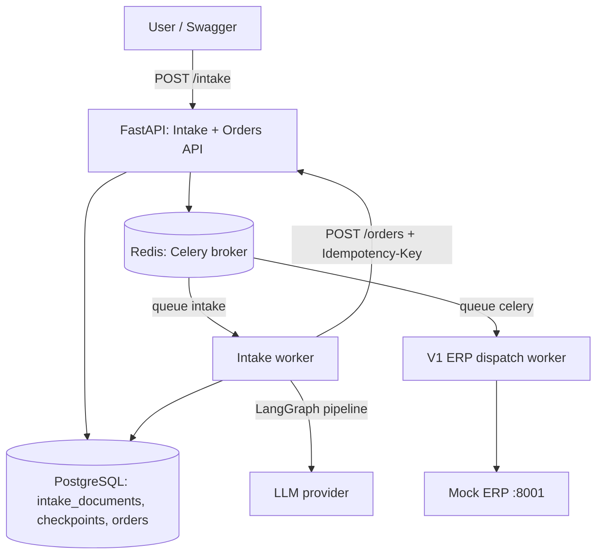
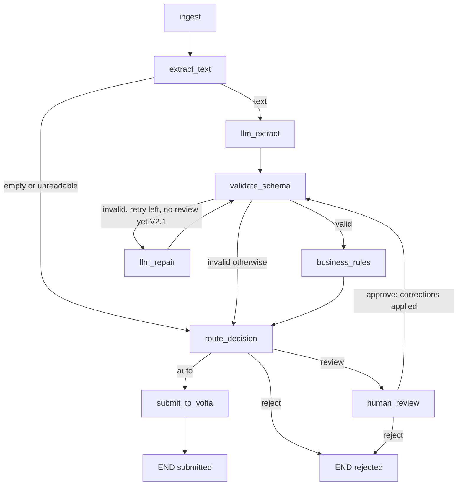

# PRD — Volta V2: AI Purchase-Order Intake

**Version:** 2.0 / 2.1
**Status:** Ready for implementation
**Revision (2026-10-22):** post-review routing policy (no infinite review loop), nullable `quantity`/`description`, explicit rejection path for unreadable files, dedicated Celery queue, stale-document retry, injected reference date for rules, intake console (V2.1).
**Language:** Python 3.12
**Audience:** Coding agent and developer
**Builds on:** Volta V1 — Order-to-ERP Integration Simulator (`PRD.md`)
**Purpose:** Portfolio and technical-interview preparation (AI Forward Deployed Engineer); not production deployment.

## 1. Product overview

Add an AI intake layer in front of Volta V1. A user uploads a purchase order (text-based PDF in V2.0, plus email in V2.1). A LangGraph pipeline extracts the text, asks an LLM for a structured draft, validates it with Pydantic, applies deterministic business rules, and decides whether the order can be submitted automatically, needs human review, or must be rejected. Accepted orders are submitted to the existing V1 Orders API, which handles persistence, ERP dispatch, and idempotency.

The project is designed to practice applied LLM engineering: structured extraction, deterministic guardrails, human-in-the-loop workflows, and evaluation of quality, cost, and latency on a held-out test set.

### Goals

1. Turn a purchase-order document into a validated, structured order without manual re-keying.
2. Implement the pipeline as a LangGraph `StateGraph` with persistent checkpoints and a human-review interrupt.
3. Route documents with deterministic business rules only — never with an LLM-declared confidence score.
4. Submit approved orders to the V1 Orders API with stable idempotency keys so the same file can never create duplicate orders. (The same PO sent again as a *different* file is a different SHA-256: it is caught by rule R10 in V2.1 only.)
5. Measure extraction quality per field, fully-correct order rate, critical errors, latency, and cost per document on a versioned test set with a sealed holdout.
6. Compare two LLM configurations on the same documents and justify the quality / cost / latency trade-off.
7. (V2.1) Provide a minimal local web console: upload a PDF on the left, see every order sent to the ERP on the right.

### Non-goals

- OCR of scanned PDFs (V2.0 and V2.1 reject them as `needs_ocr`; OCR is a future enhancement).
- Learning from human corrections, fine-tuning, or prompt auto-optimization.
- Authentication, multi-tenancy, a production-grade UI (V2.1 ships only a minimal local console, FR-13).
- Changing V1 delivery guarantees or the V1 ERP state machine.

### Guiding principle

**The LLM reads; the code decides.** A valid JSON object proves the shape of the data, never its correctness.

## 2. Users and key scenarios

**Order-desk user:** uploads purchase orders and polls their status.
**Reviewer:** inspects drafts flagged by the rules, corrects or rejects them.
**Developer:** runs the evaluation harness, compares configurations, investigates failures.
**V1 Orders API:** downstream system that persists orders and dispatches them to the mock ERP.

### Primary flow (automatic)

1. User calls `POST /intake` with a PDF file.
2. API computes the file SHA-256, stores the file, creates an `intake_documents` row with status `RECEIVED`, schedules a Celery task, and responds `202 Accepted` with the intake ID and a status URL.
3. Worker runs the LangGraph pipeline: `ingest → extract_text → llm_extract → validate_schema → business_rules → route_decision`.
4. All rules pass; `route_decision` returns `auto`.
5. `submit_to_volta` calls V1 `POST /orders` once per line with a deterministic `Idempotency-Key`.
6. Status becomes `SUBMITTED` with the list of V1 order IDs. User calls `GET /intake/{id}`.

### Alternate flows

- **Human review:** at least one rule fails. The graph pauses with `interrupt()`, status becomes `AWAITING_REVIEW`. The reviewer reads the draft and failed rules via `GET /intake/{id}/review`, then calls `POST /intake/{id}/review` with `approve` (optionally with corrections) or `reject`. On approval, the corrected draft goes back through Pydantic validation and all rules under the **post-review policy** (§6): the approval acknowledges warning and policy rules, and grounding (R5) does not apply to fields the reviewer corrected. Only remaining blocking or critical failures pause the graph again.
- **Invalid document:** not a purchase order (invoice, quote, unrelated document), no text layer, or a file that cannot be opened. Status becomes `REJECTED` with a `rejection_reason` (`not_a_purchase_order`, `needs_ocr`, `unreadable_file`); nothing is submitted. These are properties of the file — retrying cannot change them — so they are never `FAILED`.
- **Schema failure:** the LLM output does not validate. V2.0 routes to review; V2.1 first tries one `llm_repair` pass with the validation errors.
- **Duplicate upload:** same file (same SHA-256) uploaded again returns the existing intake document with `200 OK` and schedules no new work.
- **Transient LLM failure (429, 5xx, timeout):** retried inside the node with exponential backoff and jitter, bounded attempts. LLM calls have no external side effect, so retrying is safe — unlike ERP calls in V1. Budget exhausted → `FAILED`.
- **V1 unavailable:** a connection error, timeout, or 5xx on `POST /orders` is retried inside `submit_to_volta` with bounded backoff and jitter. Unlike V1 → ERP, even a timeout is safe to retry here, because every call carries its idempotency key. Budget exhausted → `FAILED`. Manual retry resumes the graph from its last checkpoint.
- **V1 returns 409** (same key, different payload — e.g. V2.1 reference data changed between two attempts of a partially submitted document): `FAILED` with `error_category = submission_conflict` and a sanitized error. Never retried, automatically or manually (`POST /intake/{id}/retry` answers `409`): it needs investigation.
- **Worker crash mid-run:** the document stays in `PROCESSING`, `SUBMITTING`, or `RESUMING`. Once `updated_at` is older than `INTAKE_STALE_AFTER_SECONDS`, it becomes eligible for manual retry (FR-05).

## 3. Functional requirements

### FR-01 Upload document

`POST /intake` (multipart, field `file`).

Validation: content type `application/pdf` in V2.0 (`message/rfc822` added in V2.1), size ≤ 10 MB, file non-empty. Wrong type or empty file → `422`; too large → `413`. Server computes SHA-256, stores the file under `INTAKE_STORAGE_DIR/{sha256}.{ext}`, and creates the row. `sha256` is unique at database level.

Response: `202 Accepted` with `id`, `status`, `source_type`, `created_at`, `status_url` (`/intake/{id}`). Same file again: `200 OK` with the existing document, no new task.

### FR-02 Read intake document

`GET /intake/{id}` returns `id`, `status`, `source_type`, `filename`, `decision` (`auto` | `review` | `reject` | null), `rejection_reason`, `draft` (nullable), `rule_results`, `submitted_order_ids`, `attempt_count`, `error_category`, `last_error` (sanitized), `usage` (tokens, latency, cost per node), `created_at`, `updated_at`. 404 for unknown IDs.

### FR-03 List intake documents

`GET /intake?status=AWAITING_REVIEW&limit=20&offset=0`; default limit 20, maximum 100; newest first; returns `items`, `total`, `limit`, `offset`.

### FR-04 Human review

- `GET /intake/{id}/review` returns the interrupt payload: current draft, failed rules, and the extracted text. 409 if the document is not `AWAITING_REVIEW`.
- `POST /intake/{id}/review` with body:

```json
{
  "action": "approve",
  "corrections": {
    "po_number": "PO-2026-0412",
    "lines": [{"line_no": 2, "quantity": 24}]
  }
}
```

`action` is `approve` or `reject`; `corrections` is optional and only allowed with `approve`. Responds `202`. Eligible only from `AWAITING_REVIEW`; a conditional status update to `RESUMING` guarantees at most one resume task for concurrent requests (409 for the loser). The review request is stored in the database together with `corrected_fields` (the paths the reviewer changed, e.g. `po_number`, `lines[2].quantity`); the Celery task receives the intake ID only and reloads it.

### FR-05 Manual retry

`POST /intake/{id}/retry` responds `202` when the document is:

- `FAILED`, except `error_category = submission_conflict`;
- or stale: `PROCESSING`, `SUBMITTING`, or `RESUMING` with `updated_at` older than `INTAKE_STALE_AFTER_SECONDS` (worker crash).

Otherwise it responds `409`. A conditional status update claims the document (one winner under concurrency). `FAILED`, `PROCESSING`, and `SUBMITTING` go back to `RECEIVED` and schedule `process_intake`. A stale `RESUMING` keeps its status and re-schedules `resume_intake` with the stored review request.

The worker re-invokes the graph with the same `thread_id` and `None` as input. LangGraph resumes from the last checkpoint, so completed nodes (including the LLM call) are not re-run. Re-running a node after a crash is safe because LLM calls have no side effect and submission is idempotent. If the original worker was only slow, not dead, both runs may submit; idempotency keys keep that harmless.

### FR-06 LangGraph pipeline

- One `StateGraph(OrderState)` built in `app/intake/graph/build.py`, compiled with a Postgres checkpointer (`langgraph-checkpoint-postgres`, `PostgresSaver`), `thread_id = str(intake_id)`.
- The checkpointer uses a `psycopg_pool.ConnectionPool` (Celery runs a thread pool; a psycopg connection must not be shared between threads), opened with `autocommit=True` and `row_factory=dict_row`. Its DSN is derived from `DATABASE_URL` by dropping the SQLAlchemy driver suffix (`postgresql+psycopg://` → `postgresql://`).
- Nodes, edges, and responsibilities are specified in §7.
- `route_decision` is a pure function of `rejection_reason`, `schema_errors`, `rule_results`, and whether a review was approved (`review`). No LLM output field may influence routing except through a rule.
- `human_review` contains exactly one `interrupt()` call and nothing before it that has side effects, because LangGraph re-runs the node from its start on resume. A rejected review ends the graph. An approved review applies the corrections and loops back to `validate_schema`, so re-validation goes through the same nodes as the first pass rather than through a second `interrupt()` inside the node.
- The worker detects a pause through the `__interrupt__` key in the invoke result and sets `AWAITING_REVIEW`.
- **Source of truth:** the checkpoint is authoritative for graph state (draft, rule results, decision). The `intake_documents` row is a projection that the worker updates after each `invoke` (and `submit_to_volta` updates it for `SUBMITTING`). The API reads only the row. If the two disagree after a crash, the next run re-projects from the checkpoint.

### FR-07 Structured extraction

- LLM accessed through `langchain.chat_models.init_chat_model` so the provider and model are configuration, not code.
- Structured output bound to `OrderDraft` (§5) via tool calling, with `include_raw=True`: LangChain would otherwise raise on invalid output, and `validate_schema` needs the raw tool-call arguments and the parsing error to fill `schema_errors` (and, in V2.1, to feed `llm_repair`).
- Prompt stored in `app/intake/llm/prompts/extract_order.md` (versioned; the prompt version is recorded in `usage`).
- Prompt requirements: extract only what is written; `null` when absent; never compute a missing total; copy values as written (no unit conversion, no correction); provide `evidence.quote` (exact source excerpt) for each line; set `document_type`; list uncertainties in `ambiguities` without resolving them; no confidence score.
- Temperature 0.
- Record input/output tokens, latency, and computed cost (from configured per-million-token prices) for each LLM call.

### FR-08 Business rules

- Each rule is a pure function `(draft: OrderDraft, ctx: RuleContext) -> list[RuleResult]` in its own module under `app/intake/rules/`, unit-tested without any LLM or network. `RuleContext` (§5) carries `raw_text`, `reference` data, `today`, and the reviewer's `corrected_fields`.
- Rules never read the clock: `today` is injected (the worker passes the current UTC date; the evaluation passes the case's `reference_date`), so a case keeps the same expected decision forever.
- Rule catalog, severities, and versions are in §6.
- Tolerances, caps, and thresholds live in settings (`app/core/config.py`) and are calibrated on the dev split only.

### FR-09 Submission to V1

- `submit_to_volta` calls V1 `POST /orders` over HTTP (`httpx.Client`, base URL `ORDERS_API_BASE_URL`), one call per draft line.
- Mapping (V2.0): `customer_id ← buyer_customer_code`, `product_id ← sku`, `quantity ← quantity` (must be an integer; enforced by R2). Prices are used by rules only; V1 orders carry no price.
- Mapping (V2.1): `customer_id` and `product_id` come from the reference tables (R7, R8).
- `Idempotency-Key: intake-{sha256}-{line_no}`. Re-submitting a document, after a crash or a manual retry, returns the same V1 orders (V1 answers `202` both times; a replay carries `Idempotent-Replayed: true`).
- Transient failures (connection error, timeout, 5xx) are retried inside the node with exponential backoff and jitter, at most `SUBMIT_MAX_ATTEMPTS` per line.
- Store returned V1 order IDs in `submitted_order_ids`. Partial failure (some lines submitted): status `FAILED`; manual retry completes the remaining lines safely thanks to idempotency.
- This per-line mapping is a deliberate V2 trade-off: V1 orders are single-line. Document it in README; multi-line V1 orders are a future enhancement.

### FR-10 Email intake (V2.1)

- Accept `.eml` files. Parse with the standard library `email` package.
- If a PDF attachment exists, extract its text; also keep the plain-text body (signatures and quoted replies stripped).
- Both texts are passed to the LLM with clear section markers; a quantity correction in the body must surface either as the corrected value with evidence or as an `ambiguities` entry.

### FR-11 Evaluation harness

`uv run python -m evals.run_eval --config A --split dev --runs 3`

- Runs the compiled graph in-process with an in-memory checkpointer and submission disabled (dry run): evaluates the draft and the routing decision, never calls V1.
- Compares results with `expected.json` and `meta.yaml` per case, computes the metrics of §11, and writes `evals/reports/{timestamp}_{config}_{split}.json` and `.md`.
- The report lists every error: case, field, expected value, actual value, decision.
- `--split holdout` requires an explicit `--confirm-holdout` flag.
- Cases whose `meta.yaml` `min_version` is above the evaluated version (`--version 2.0|2.1`, default `2.1`) are skipped, and the report says how many.
- Rules receive the case's `reference_date` as `today`.

### FR-12 Observability

- Structured logs with `intake_id`, `sha256`, `node`, `event`, `decision`, `attempt`, error category; never log API keys or full document text.
- Per-node latency and token usage stored in `usage` (database-backed, as in V1).
- V2.1: traces in Langfuse or LangSmith, enabled by environment variable only.

### FR-13 Intake console (V2.1)

A single local web page, `GET /console`, served by the FastAPI app on port 8000. It uses static HTML, CSS, and vanilla JavaScript (no framework, no build step) and calls only the existing JSON endpoints.

Layout: two columns on desktop, stacked on narrow screens.

| Left — intake | Right — ERP orders |
|---|---|
| Drop zone + file picker (`application/pdf`, plus `.eml` in V2.1) → `POST /intake` | Table from V1 `GET /orders` |
| Inline result: `202` new document, `200` "already received" (duplicate), `413`/`422` with the error message | Columns: created at, customer, product, quantity, V1 status, `erp_order_id`, attempts, last error |
| List of recent intake documents (`GET /intake`): filename, status, decision, number of submitted orders | Status filter (all, `PENDING`, `PROCESSING`, `SUCCESS`, `FAILED`, `UNKNOWN`), newest first, "load more" (offset pagination, 50 per page) |
| `AWAITING_REVIEW` rows link to the review page (`/console/review/{id}`, Milestone V2.1-4) | `SUCCESS` = confirmed by the ERP; `UNKNOWN` highlighted (needs reconciliation) |

Behavior:

- Both panels refresh by polling every 5 s while the tab is visible (`document.visibilityState`). No WebSocket.
- The right panel shows V1 orders, not the mock ERP's table. Every order ever sent to the ERP is a V1 order, and V1 also shows orders still in flight and orders the ERP rejected. The ERP's own reference is the `erp_order_id` column. This also avoids adding a list endpoint and CORS to the mock ERP.
- **Every value is rendered with `textContent`, never `innerHTML`.** Draft fields come from an LLM reading an untrusted document, so a PO containing `<script>` must not execute in the console.
- No authentication (non-goal). The API stays bound to `127.0.0.1`.

| Status | Meaning | Typical next status |
|---|---|---|
| `RECEIVED` | File stored (or retry requested), task scheduled | `PROCESSING` |
| `PROCESSING` | Worker is running the graph | `AWAITING_REVIEW`, `SUBMITTING`, `REJECTED`, `FAILED`; `RECEIVED` via retry when stale |
| `AWAITING_REVIEW` | Graph paused at `interrupt()` | `RESUMING` |
| `RESUMING` | Review submitted, resume task scheduled | `PROCESSING`; re-scheduled via retry when stale |
| `SUBMITTING` | Sending lines to V1 | `SUBMITTED`, `FAILED`; `RECEIVED` via retry when stale |
| `SUBMITTED` | All lines accepted by V1 | Terminal |
| `REJECTED` | Invalid or unreadable document, or reviewer rejection | Terminal |
| `FAILED` | Technical failure (LLM or V1 budget exhausted, V1 409) | `RECEIVED` via manual retry (not after a 409) |

`process_intake` claims `RECEIVED → PROCESSING` and `resume_intake` claims `RESUMING → PROCESSING`, both by conditional update. A redelivered message that finds another status does nothing.

`decision` (auto / review / reject) is a separate field: it records the routing outcome, while `status` records processing progress. `error_category` (`llm_unavailable`, `submission_unavailable`, `submission_conflict`, `unexpected`) is set with `FAILED` and logged. `SUBMITTED` does not mean the ERP received the order — that is V1's status, visible through V1 `GET /orders/{id}`.

## 5. Data model

### `intake_documents`

| Field | Type / constraint |
|---|---|
| `id` | UUID primary key |
| `sha256` | unique non-null varchar(64) |
| `source_type` | `pdf` or `email` |
| `filename` | non-null varchar |
| `storage_path` | non-null varchar |
| `status` | enum/string with validation |
| `decision` | nullable `auto` / `review` / `reject` |
| `rejection_reason` | nullable varchar |
| `raw_text` | nullable text |
| `draft` | nullable JSONB (`OrderDraft`) |
| `schema_errors` | JSONB, default `[]` |
| `rule_results` | JSONB, default `[]` |
| `review_request` | nullable JSONB (last reviewer action + corrections) |
| `submitted_order_ids` | JSONB, default `[]` (V1 order UUIDs) |
| `llm_model`, `prompt_version` | nullable varchar |
| `usage` | JSONB, default `{}` |
| `attempt_count` | integer default 0 |
| `error_category` | nullable varchar |
| `last_error` | nullable text, sanitized |
| `created_at`, `updated_at` | timezone-aware UTC |

LangGraph checkpoint tables are created by `PostgresSaver.setup()`; do not hand-write them in Alembic.

### V2.1 reference tables

`customers` (`code` unique, `name`, `vat_number`, `created_at`), `products` (`sku` unique, `description`, `unit`, `list_price` numeric, `max_quantity`), `product_aliases` (`alias` unique, `sku` FK). Seeded from `evals/reference/*.csv` by a CLI command.

### Pydantic models

```python
class Evidence(BaseModel):
    quote: str                     # exact excerpt of the source text

class Address(BaseModel):
    name: str | None
    street: str | None
    postal_code: str | None
    city: str | None
    country: str | None

class OrderLine(BaseModel):
    line_no: int
    sku: str | None                # as written; None if absent
    description: str | None        # R1: SKU or description required
    quantity: Decimal | None       # R1: required; R2: > 0, integer, capped
    unit: str | None               # "pce", "carton of 12", ...
    unit_price: Decimal | None     # R3: >= 0
    line_total: Decimal | None
    evidence: Evidence

class OrderDraft(BaseModel):
    model_config = ConfigDict(extra="forbid")
    document_type: Literal["purchase_order", "invoice", "quote", "other"]
    po_number: str | None
    order_date: date | None
    requested_delivery_date: date | None
    buyer_name: str | None
    buyer_customer_code: str | None
    ship_to: Address | None
    currency: Literal["EUR", "USD", "GBP", "CHF"] | None
    lines: list[OrderLine]
    subtotal: Decimal | None
    tax_total: Decimal | None
    total: Decimal | None
    ambiguities: list[str] = []    # reported by the LLM, never resolved by it

class Severity(StrEnum):
    REJECT = "reject"              # not a purchase order: end the graph
    CRITICAL = "critical"          # the value may be invented: never auto
    BLOCKING = "blocking"          # missing or inconsistent data
    WARNING = "warning"            # suspicious; a reviewer approval acknowledges it
    POLICY = "policy"              # business choice (amount); approval acknowledges it

class RuleResult(BaseModel):
    code: str                      # "R3"
    severity: Severity
    passed: bool
    field: str | None              # "lines[2].line_total"
    message: str

@dataclass(frozen=True)
class RuleContext:
    raw_text: str
    reference: ReferenceData | None   # V2.1 catalog and customers; None in V2.0
    today: date                       # injected; rules never read the clock
    corrected_fields: frozenset[str]  # paths changed by the reviewer; empty before review
```

Draft fields are nullable on purpose. A required field — or a constraint like `gt=0` — would turn a missing or bad value into a schema error, and would push the LLM to invent a value that validates. **The schema checks shape; the rules check values.** Absence is handled by R1 and ranges by R2/R3. There is no `confidence` field.

## 6. Business rules and routing policy

| Code | Check | Severity | Version |
|---|---|---|---|
| R0 | `document_type` ≠ `purchase_order` | Reject | V2.0 |
| R1 | Required: PO number, order date, customer code, ≥ 1 line; on each line a quantity and a SKU or description | Blocking | V2.0 |
| R2 | Quantity > 0, integer (V1 constraint), below a per-product or global cap | Blocking | V2.0 |
| R3 | Unit price ≥ 0; `quantity × unit_price = line_total` when all present (tolerance 0.01) | Blocking | V2.0 |
| R4 | Sum of lines = subtotal; subtotal + tax = total (tolerance 0.01) | Blocking | V2.0 |
| R5 | Grounding: each `evidence.quote`, PO number, SKU, and quantity found in `raw_text` (whitespace- and case-normalized, number formats normalized); fields in `corrected_fields` are exempt — the reviewer is their source | Critical | V2.0 |
| R6 | Dates: delivery ≥ order date, delivery ≥ `ctx.today` | Warning | V2.0 |
| R12 | `ambiguities` not empty | Warning | V2.0 |
| R7 | SKU found in catalog (exact or known alias) | Blocking | V2.1 |
| R8 | Customer found in reference table | Blocking | V2.1 |
| R9 | Unit price within ± 5 % of catalog list price | Warning | V2.1 |
| R10 | PO number already received for this customer | Blocking | V2.1 |
| R11 | Total above `REVIEW_AMOUNT_THRESHOLD` | Policy | V2.1 |

Routing (`route_decision`):

```text
if rejection_reason or R0 failed              -> reject
elif schema_errors                            -> review
elif review approved:                         # post-review policy
    if any blocking or critical rule failed   -> review   (pause again)
    else                                      -> auto     (warnings/policy acknowledged)
elif any rule failed                          -> review
else                                          -> auto
```

`rejection_reason` is set before any rule runs when there is nothing to evaluate. `extract_text` sets it for no text layer (`needs_ocr`) or a file that cannot be opened (`unreadable_file`). `validate_schema` sets it when the draft is invalid but its raw `document_type` is a valid value other than `purchase_order` (`not_a_purchase_order`), so an invoice with a malformed draft is still rejected rather than sent to review.

Post-review policy: a reviewer's approval is a human decision about warning and policy rules (an off-list price, a high amount, a reported ambiguity). Re-raising them would loop forever, since no correction can make them disappear. Blocking and critical rules still apply after review: a correction that leaves a total inconsistent is sent back. Severities therefore matter for routing only after review; before review, any failure routes to review. They are also reported separately in evaluation metrics.

Why not the LLM's confidence: a self-reported score is not calibrated; a model can be "confident" about an invented reference. Rules are verifiable and reproducible.

Orders that stay in human review by design: ambiguities only a human can resolve ("same as last time", cartons vs units, two delivery addresses); documents wrong at the source (a wrong total is fixed with the customer, not by the model); high amounts; effects that are hard to undo downstream.

## 7. Architecture

### System



Intake tasks are routed to a dedicated `intake` queue (`task_routes` in `app/workers/celery_app.py`) and consumed by a separate worker process. An LLM call can last up to `LLM_TIMEOUT_SECONDS × LLM_MAX_ATTEMPTS`, and sharing V1's four worker threads would let a few documents starve ERP dispatch. The V1 worker command is unchanged and keeps consuming the default `celery` queue.

Intake, Orders, and console routers live in the same FastAPI app (port 8000). The intake worker talks to the Orders API over HTTP rather than calling `order_service` directly: the boundary stays explicit and V1 idempotency is reused as-is.

### LangGraph



| Node | Role | LLM |
|---|---|---|
| `ingest` | Load file, set `source_type`, `document_id` | No |
| `extract_text` | pdfplumber text + tables (tables serialized as pipe rows); no text → `rejection_reason = needs_ocr`; cannot open → `unreadable_file` | No |
| `llm_extract` | Structured output `OrderDraft` (`include_raw=True`) | Yes |
| `validate_schema` | Pydantic validation, fill `schema_errors`; non-PO `document_type` → `rejection_reason = not_a_purchase_order` | No |
| `llm_repair` | Send draft + validation errors back, 1 retry max (V2.1); never after a review — a reviewer's input is not sent to the LLM | Yes |
| `business_rules` | Run all rules with `RuleContext`, fill `rule_results` | No |
| `route_decision` | Pure routing function, post-review policy included (§6) | No |
| `human_review` | One `interrupt()` with draft + failed rules + text; on approve, apply corrections and record `corrected_fields`; on reject, set `rejection_reason = rejected_by_reviewer` | No |
| `submit_to_volta` | One V1 order per line with idempotency key, bounded retries | No |

### `OrderState`

```python
class OrderState(TypedDict):
    intake_id: str
    source_type: Literal["pdf", "email"]
    file_path: str
    raw_text: str | None
    draft: dict | None             # OrderDraft.model_dump(mode="json")
    schema_errors: list[str]
    retries: int
    rule_results: list[dict]
    decision: Literal["auto", "review", "reject"] | None
    rejection_reason: str | None
    review: dict | None            # {"action", "corrections", "corrected_fields"}
    submitted_order_ids: list[str]
    usage: dict
```

State values are JSON-serializable so checkpoints stay readable and portable. Nodes convert to and from Pydantic models at their boundaries.

## 8. Repository layout

Additions to the V1 repository:

```text
erpProject/
├── app/
│   ├── api/intake.py                  # upload, read, list, review, retry
│   ├── api/console.py                 # V2.1: serves the console pages
│   ├── static/console/                # V2.1: index.html, review.html, console.js, console.css
│   ├── models/intake_document.py
│   ├── models/reference.py            # V2.1
│   ├── schemas/intake.py              # API request/response models
│   ├── intake/
│   │   ├── graph/state.py
│   │   ├── graph/build.py
│   │   ├── graph/setup_checkpointer.py  # runs PostgresSaver.setup()
│   │   ├── graph/nodes/               # one module per node
│   │   ├── extraction/pdf_text.py
│   │   ├── extraction/email_parser.py # V2.1
│   │   ├── llm/order_draft.py         # OrderDraft, OrderLine, Evidence
│   │   ├── llm/client.py              # init_chat_model, retries, usage
│   │   ├── llm/prompts/extract_order.md
│   │   ├── rules/                     # r00_document_type.py ... engine.py
│   │   ├── routing.py
│   │   └── submission.py              # Orders API client
│   └── workers/intake_tasks.py        # process_intake, resume_intake
├── evals/
│   ├── reference/products.csv, customers.csv
│   ├── generator/                     # PDF + expected.json from one source
│   ├── dev/C001/{input.pdf, expected.json, meta.yaml}
│   ├── holdout/                       # DO NOT READ (see §14)
│   ├── holdout.sha256
│   ├── scoring.py
│   ├── run_eval.py
│   └── reports/
├── tests/intake/
│   ├── test_rules.py
│   ├── test_routing.py
│   ├── test_pdf_text.py
│   ├── test_graph.py                  # fake LLM, interrupt/resume
│   ├── test_intake_api.py
│   ├── test_console.py                # V2.1
│   └── test_intake_end_to_end.py
└── V2_SPECS.md
```

Keep separation: HTTP routes, persistence, graph orchestration, LLM access, rules, and the V1 client are distinct modules.

## 9. Technical stack and environment

Same stack as V1, plus:

```bash
uv add langgraph langgraph-checkpoint-postgres langchain langchain-anthropic pdfplumber python-multipart
uv add --dev weasyprint scipy
```

- `scipy.optimize.linear_sum_assignment` matches expected and extracted lines in evaluation.
- WeasyPrint is needed only by the test-case generator (on macOS: `brew install pango`).
- Keep synchronous code in the worker and services, as in V1. Use the synchronous LangGraph API (`invoke`) and `PostgresSaver` over a psycopg 3 connection pool (FR-06).

New `.env.example` entries:

```text
LLM_MODEL=claude-haiku-5-5
LLM_PROVIDER=anthropic
ANTHROPIC_API_KEY=
LLM_TIMEOUT_SECONDS=60
LLM_MAX_ATTEMPTS=3
LLM_PRICE_INPUT_PER_MTOK=
LLM_PRICE_OUTPUT_PER_MTOK=
ORDERS_API_BASE_URL=http://127.0.0.1:8000
SUBMIT_MAX_ATTEMPTS=3
INTAKE_STORAGE_DIR=./var/intake
INTAKE_MAX_FILE_MB=10
INTAKE_STALE_AFTER_SECONDS=900
RULE_AMOUNT_TOLERANCE=0.01
RULE_MAX_QUANTITY=10000
RULE_PRICE_TOLERANCE_PCT=5
REVIEW_AMOUNT_THRESHOLD=5000
TRACING_ENABLED=false
```

Prices are configuration: look them up on the provider's pricing page; never hard-code them. `var/` and `.env` are git-ignored.

Run locally (in addition to the V1 processes):

```bash
uv run alembic upgrade head
uv run python -m app.intake.graph.setup_checkpointer
uv run celery -A app.workers.celery_app:celery_app worker -Q intake -n intake@%h --loglevel=info
```

`INTAKE_STALE_AFTER_SECONDS` must exceed the longest possible run (LLM and submission retries included), otherwise a slow but healthy run could be retried in parallel. That would be harmless thanks to idempotency, but wasteful.

## 10. Test set

74 cases in 8 families of increasing difficulty. 52 dev cases, 22 sealed holdout cases.

| # | Family | Examples | Dev | Holdout | Expected decision | Version |
|---|---|---|---|---|---|---|
| 1 | Nominal | 1–5 lines, clean table, consistent totals | 7 | 3 | auto | V2.0 |
| 2 | Layouts | Multi-page, borderless table, description on 2 lines, repeated header | 8 | 4 | auto | V2.0 |
| 3 | Locale formats | `1.234,56` vs `1,234.56`, unambiguous day-first dates (day > 12, e.g. `23/04/2026`), month names, English PO | 6 | 2 | auto | V2.0 |
| 4 | Missing fields | No PO number, no date, no price, no customer | 6 | 2 | review | V2.0 |
| 5 | Ambiguities | Two addresses, customer vs supplier SKU, cartons vs units, global discount, ambiguous date (`03/04/2026` with no locale hint) | 7 | 3 | review | V2.0 |
| 6 | Inconsistencies | Wrong total, qty × price ≠ line total (V2.0); unknown SKU, duplicate PO, off-list price (V2.1, `min_version: "2.1"`) | 7 | 3 | review | V2.0 / V2.1 |
| 7 | Invalid documents | Invoice, quote, scanned PDF without text, corrupted PDF, unrelated document | 5 | 3 | reject | V2.0 |
| 8 | Emails | Body only, body + PDF, quantity correction in body | 6 | 2 | auto or review | V2.1 |
| | **Total** | | **52** | **22** | | |

Each case directory contains `input.pdf` (or `input.eml`), `expected.json` (ground truth in `OrderDraft` format), and `meta.yaml`:

```yaml
id: C014
family: 5
expected_decision: review
min_version: "2.0"          # "2.1" for cases that need R7–R11 or email intake
reference_date: 2026-10-15  # passed to rules as `today`
critical_fields: [buyer_customer_code, lines.sku, lines.quantity, total]
notes: "Two delivery addresses, none marked as default"
```

A genuinely ambiguous value belongs in family 5 (expected `review`), never in an `auto` family: a model that correctly reports the ambiguity must not be scored as a routing error.

Generation rules:

- `evals/generator/` produces each PDF **and** its `expected.json` from the same data, so annotations cannot drift.
- Fictional catalog (~200 SKUs) and 20 customers in `evals/reference/`.
- Four HTML → PDF templates for dev; a **fifth template used only in holdout** to measure generalization rather than memorization.
- About 10 hand-made cases to break the generator's regularity.

Holdout rules:

- At least 2 cases per family.
- `evals/holdout.sha256` committed when the holdout is created; `run_eval` verifies it.
- One holdout session per final configuration (that session is the 3 runs of §11). Any later change is documented in the report.
- Never used to tune prompts, rules, or thresholds.

## 11. Evaluation metrics

The deciding metric is **escaped critical errors**: zero on the holdout. Other metrics arbitrate between configurations that meet it. Targets are starting hypotheses, revised after the first dev run.

| Metric | Definition | Target (V2.1) |
|---|---|---|
| Escaped critical errors | Wrong value on a critical field in a document routed `auto` | 0 (eliminatory) |
| Caught critical errors | Same error, routed to review | Tracked |
| Field accuracy | Normalized value equals ground truth (exact decimals, ISO dates, trimmed case-insensitive strings) | ≥ 95 % on critical fields |
| Line precision / recall | Lines matched by SKU, else description (Hungarian matching) | ≥ 98 % / ≥ 98 % |
| Fully-correct orders | All critical fields and all lines exact | ≥ 85 % of valid cases |
| Routing quality | Confusion matrix expected vs actual (auto / review / reject) | Review recall = 100 % |
| Automation rate | Cases routed `auto` and correct / all cases | Maximize under the constraint |
| Ungrounded values | Extracted values absent from source text | 0 after R5 |
| Latency | p50 / p95 per document, per-node breakdown, excluding human wait | p95 < 20 s |
| Cost per document | Tokens × configured prices, retries included | Measured |
| Cost per correct auto order | Total cost ÷ correct documents routed `auto` | Comparison criterion |
| Valid JSON rate | Output conforms to `OrderDraft` | Hygiene only |

Each configuration runs 3 times on the same split at temperature 0; report mean and spread. A result that changes between runs is not reliable enough to automate.

Statistical honesty: 0 escaped critical errors on 22 holdout documents still allows a true rate of up to ~13 % (95 % upper bound, "rule of three": 3 / 22). The report states this bound and presents the result as "no escape observed", not "no escape possible".

## 12. Configuration comparison (V2.1)

Same graph, prompt, rules, and documents. Only the model behind `llm_extract` and `llm_repair` changes.

| | Config A — light | Config B — robust |
|---|---|---|
| Model | Small, fast model (e.g. Claude Haiku 5.5) | More capable model (e.g. Claude Sonnet 5.5) |
| Strategy | 1 pass + 1 repair | 1 pass + 1 repair |

Decision grid, in order:

1. Eliminatory: 0 escaped critical errors on the holdout, across all 3 runs.
2. Rate of correct documents routed `auto`.
3. Cost per correct auto order — a cheaper model that sends more to review can cost more overall.
4. p95 latency.

Optional, measured on dev first: a **cascade** (A by default, B called only when a blocking rule fails). Keep it only if it meets criterion 1.

## 13. Implementation roadmap

### V2.0 — working pipeline (target: demo-ready before 2026-11-03)

#### Milestone V2.0-1 — Test set first (approx. 3 hours)

- Reference CSVs, generator, four templates, 25–30 dev cases for families 1–7.
- **Acceptance:** each case has `input.pdf`, `expected.json`, `meta.yaml`; generated PDFs have a text layer except deliberate scanned cases; `expected.json` validates against `OrderDraft`.

#### Milestone V2.0-2 — Models, persistence, upload API (approx. 2 hours)

- `OrderDraft` and related models, `intake_documents` model + Alembic migration, `POST /intake`, `GET /intake/{id}`, `GET /intake`.
- **Acceptance:** upload returns 202; same file returns 200 with the same ID; invalid type returns 422; unknown ID returns 404.

#### Milestone V2.0-3 — Extraction nodes (approx. 3 hours)

- `ingest`, `extract_text`, `llm_extract` (with retries and usage), `validate_schema`.
- **Acceptance:** unit tests with a fake chat model; a live call on 3 dev cases produces valid drafts; usage recorded.

#### Milestone V2.0-4 — Rules and routing (approx. 2–3 hours)

- R0–R6 and R12 as pure functions, rule engine, `route_decision`.
- **Acceptance:** one passing and one failing unit test per rule; routing table fully covered, post-review policy included; R6 uses the injected `today`.

#### Milestone V2.0-5 — Graph, checkpoints, human review (approx. 3 hours)

- Graph assembly, `PostgresSaver` over a connection pool, `intake` Celery queue, tasks `process_intake` and `resume_intake`, review and retry endpoints (stale retry included).
- **Acceptance:** a review case pauses with `AWAITING_REVIEW`, resumes after `POST /intake/{id}/review`; concurrent review requests schedule one task; corrections leaving a blocking failure pause again; approval with only warning/policy failures submits; a worker restart mid-review loses nothing; a stale `PROCESSING` document can be retried.

#### Milestone V2.0-6 — Submission to V1 (approx. 2 hours)

- `submit_to_volta` with per-line idempotency keys.
- **Acceptance:** an auto case creates V1 orders that reach `SUCCESS` through the mock ERP; uploading or retrying the same document creates no additional V1 orders.

#### Milestone V2.0-7 — Evaluation and demo (approx. 2–3 hours)

- `run_eval.py` and `scoring.py`: field accuracy, fully-correct orders, routing matrix, tokens, latency, cost. README section with three demo scenarios (auto, review then approve, reject).
- **Acceptance:** a report is generated on the dev split; another developer reproduces the three demos from README commands.

### V2.1 — complete

#### Milestone V2.1-1 — Full test set and sealed holdout (approx. 3 hours)

- 74 cases including family 8; fifth template; holdout hash committed.
- **Acceptance:** 52 dev / 22 holdout; `run_eval` refuses holdout without `--confirm-holdout` and fails on hash mismatch.

#### Milestone V2.1-2 — Reference data and rules R7–R11 (approx. 3 hours)

- Reference tables, seed command, SKU and customer resolution, rules R7–R11.
- **Acceptance:** unit tests per rule; submission uses resolved IDs.

#### Milestone V2.1-3 — Repair loop and email intake (approx. 3 hours)

- `llm_repair` (1 retry), `.eml` parsing with attachment and body.
- **Acceptance:** a forced schema error is repaired or routed to review; family 8 cases run end to end.

#### Milestone V2.1-4 — Observability and review screen (approx. 2 hours)

- Tracing behind `TRACING_ENABLED`; minimal HTML review page at `/console/review/{id}` (draft, failed rules, editable fields, approve / reject), built with the same static stack and `textContent` rule as the console (FR-13).
- **Acceptance:** a trace shows every node of one run; a reviewer completes a review without Swagger.

#### Milestone V2.1-5 — Intake console (approx. 2 hours)

- `GET /console` (FR-13): upload on the left, V1 orders on the right, polling, status filter, pagination; links to the review page.
- **Acceptance:** uploading a PDF from the console shows it in the left list and, once submitted, its orders appear on the right with their ERP status; a duplicate upload shows "already received"; a PO whose fields contain `<script>` renders as text.

#### Milestone V2.1-6 — Comparison and report (approx. 3 hours)

- Calibrate thresholds on dev for A and B; freeze settings; run holdout once per configuration.
- **Acceptance:** report with the §12 table filled in and an argued recommendation, including which orders must stay under human review.

**Estimated total:** V2.0 17–19 hours, V2.1 16 hours; planning guidance, not a commitment.

## 14. Test plan and acceptance criteria

Automated with pytest (fake chat model for unit and graph tests; live LLM only in the evaluation harness):

- Every rule: one passing and one failing case.
- `route_decision`: reject (rejection reason), reject (R0), review (schema errors), review (rule failure), auto; after approval: warning/policy failures → auto, blocking failure → review.
- R5 skips fields listed in `corrected_fields`.
- `extract_text`: text PDF returns text and tables; scanned PDF sets `needs_ocr`; corrupted PDF sets `unreadable_file` (status `REJECTED`, not `FAILED`).
- Graph with fake LLM: auto path reaches `submit_to_volta`; review path pauses at `interrupt`; resume with valid corrections submits; resume with corrections leaving a blocking failure pauses again; approval of a document failing only R11 or R12 submits; reject path ends without submission.
- Retry: allowed from `FAILED` and stale in-flight statuses; refused (`409`) after `submission_conflict` and for fresh in-flight documents.
- Console (V2.1): `GET /console` returns HTML; the page script uses no `innerHTML`.
- Upload: 202, duplicate 200, wrong type 422, unknown 404.
- Concurrent `POST /intake/{id}/review` schedules a single resume.
- Retry from `FAILED` resumes from checkpoint without a second LLM call.
- Submission: idempotency keys stable; repeated submission creates no extra V1 orders (integration test against the running V1 API).
- LLM transient error retried; budget exhausted → `FAILED`.
- API keys and full document text never appear in logs.
- `uv run ruff check .` and `uv run pytest` pass.

## 15. Definition of done

**V2.0 is done when:**

- [ ] A text PDF goes through the graph end to end and becomes V1 orders.
- [ ] A rule failure pauses the graph; review approval resumes and submits.
- [ ] Invalid documents are rejected with a reason.
- [ ] Re-uploading or retrying a document never duplicates V1 orders.
- [ ] `run_eval` produces a dev report with field accuracy, fully-correct rate, routing matrix, latency, and cost.
- [ ] README explains setup, architecture, limitations, and the three demo scenarios.

**V2.1 is done when, in addition:**

- [ ] Email intake, reference rules, and the repair loop work.
- [ ] The console lets a user upload a PDF and follow the resulting orders to their ERP status.
- [ ] The holdout is sealed and run once per configuration.
- [ ] The comparison report justifies the chosen configuration and the review policy.

## 16. Future enhancements

1. OCR for scanned PDFs (e.g. a vision-capable model or Tesseract) as a new branch after `extract_text`.
2. Multi-line orders in V1, replacing per-line submission.
3. Learning from reviewer corrections (few-shot examples, alias suggestions).
4. Cascade routing between models in production.
5. Mailbox polling instead of manual upload.
6. Confidence calibration from observed error rates per field and per family, still enforced by rules.

## 17. Instructions for the coding agent

1. Treat this document as the source of truth for V2; `PRD.md` remains the source of truth for V1. Implement milestones in order; do not start V2.1 before V2.0 acceptance criteria pass.
2. Read the existing V1 code before Milestone V2.0-2 and V2.0-6; reuse its settings, session, logging, and Celery setup. Report any conflict with this document instead of working around it.
3. Before each milestone, state the files to create or change and the verification commands. After each milestone, run tests and lint, fix failures, and summarize what works and what remains.
4. The LLM extracts; code decides. Never add a `confidence` field or route on any LLM output except through a rule.
5. Never open, print, or use files under `evals/holdout/` unless the user explicitly asks for the final holdout run.
6. Keep LLM calls inside `llm_extract` and `llm_repair`; use a fake chat model in tests.
7. Never submit to V1 without the deterministic idempotency key.
8. Keep secrets out of version control; provide safe `.env.example` defaults.
9. When a choice is underspecified, choose the simplest safe approach and document the trade-off in README.